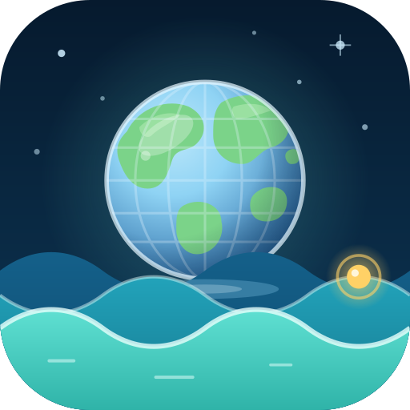

  

# Onda — do mundo até você

Radar geopolítico pessoal: reúne notícias do mundo inteiro, destaca a mais
importante do dia e ajuda a montar a **cadeia de efeitos** de cada fato até
o dia a dia no Brasil.

A visão completa do projeto está em [`docs/VISAO.md`](docs/VISAO.md).

## Como está organizado

| Pasta | O que tem |
|---|---|
| `coletor/` | O robô que busca as notícias (JavaScript, roda no GitHub Actions). |
| `data/fontes.json` | A lista de fontes: país, visão editorial e endereço do feed. |
| `data/noticias/` | As notícias coletadas: um arquivo por dia e o `hoje.json`. |
| `data/relatorio-coleta.json` | O que funcionou e o que falhou na última coleta. |
| `assets/logo/` | O logo do Onda. |
| `docs/` | Documentação do projeto. |

## Etapas

- [x] 1. Coleta de notícias
- [ ] 2. Tela do dia (app instalável)
- [ ] 3. Login e "acompanhar"
- [ ] 4. Cadeia de efeitos
- [ ] 5. Biblioteca de temas
- [ ] 6. Histórico
- [ ] 7. Pesquisa e IA automáticas
